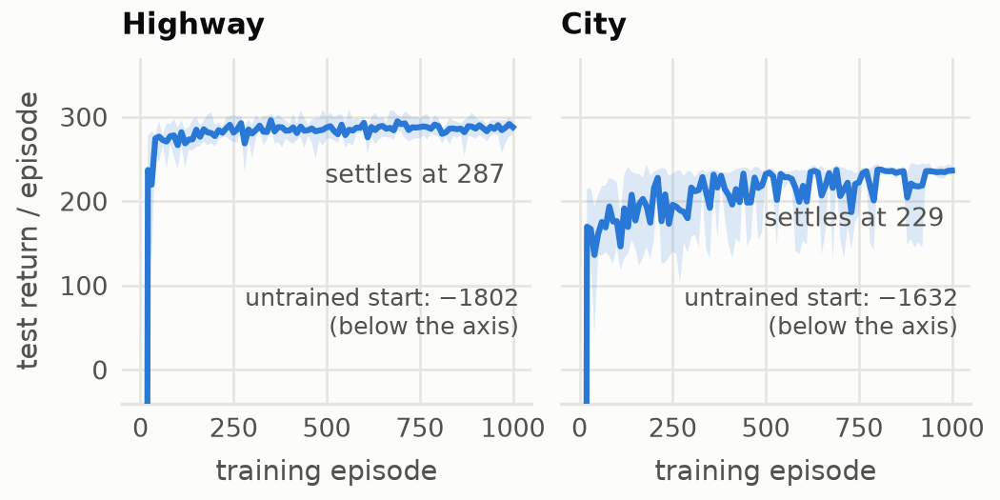
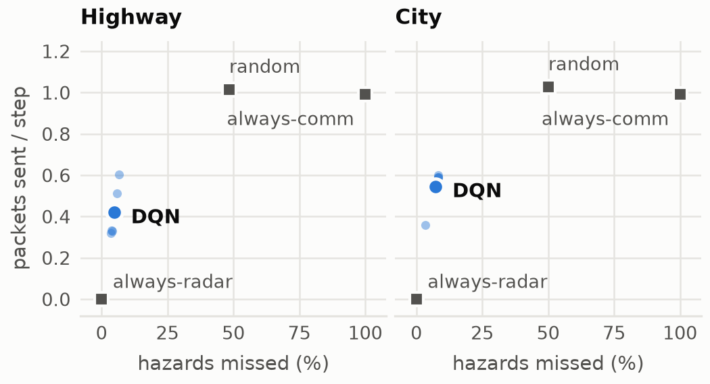

# RadCom-RL: radar vs. communication time-sharing for a connected vehicle

AI course CSL3090 (2026), Assignment 2: Mini Project [RL].
Divya Kumar (B23EE1019), IIT Jodhpur. Solo team. Report: [`report/report.pdf`](report/report.pdf).

A car has one shared radio front-end. Every 100 ms it must choose one job:
**sense** with the radar, or **send** V2X data. A DQN agent learns from road
hazard, channel quality and queue state to minimise missed hazards and dropped
urgent messages.

## Where this code comes from (please read first)

- **My B.Tech project.** The environment and the DQN training in `src/` come
  from my own B.Tech project, *"Intelligent Joint Radar-Communication System
  for Automotive Vehicles"* (supervisor: Prof. Pradyumna Kumar Bishoyi,
  Electrical Engineering, IIT Jodhpur), presented on 27 Oct 2026. That project
  was not a git repository, so the **first commit here imports it as it was**.
  The later commits add what was made for this course: the comparison with
  baseline policies (`src/evaluate.py`), the report figures and the report.
- **The base paper.** The model extends **iRDRC** (Hieu et al., IEEE Wireless
  Communications Letters, 2020). The idea of a DQN choosing radar or
  communication every step is theirs. What this project changes is listed
  below and at the top of `src/config.py`.
- **The DQN library.** The DQN is **Stable-Baselines3** (Raffin et al., JMLR
  2021), installed with `pip` and imported, the library my supervisor pointed
  me to. No code from the Stable-Baselines3 repository, or from any other
  repository, is copied here.

Some code comments point to B.Tech scripts that are not part of this course
submission (the parameter sweeps behind the B.Tech figures).

## The RL formulation

**State** (7 values, all scaled to 0-1): queue length `d/10`, channel bad `c`,
rain or wet road `e`, speed above 60 km/h `v`, object nearby `m` (a blind
spot), road-info report waiting `i`, urgent report waiting `u`. That gives
11 x 2^6 = 704 distinct observations. Whether a hazard happens this step is
hidden: only the radar reveals it, and only by giving up the step.

**Action** (discrete): `0` communicate, `1` radar.

**Environment** (`src/env.py`, every number with its source in `src/config.py`):

- Each step is 100 ms (the 10 Hz rate of V2X safety messages); an episode is
  200 steps, 20 s of driving.
- Hazard chance: `1 - (1-p_e)(1-p_v)(1-p_m)`, each `p` taken from the factor's
  observed state (noisy-OR, so it never goes above 1).
- Channel bad: `1 - (1-q_base)(1-0.5 g)(1-0.05 v)`, where `g` (hidden) means
  the car is between roadside units.
- Packets: routine status messages arrive Poisson(1) per step. A hazard the
  radar catches becomes a road-info report, or an urgent one when all three
  conditions are bad. A send moves 4 packets on a good channel, 2 on a bad one,
  urgent first; a full buffer (10) drops routine first.
- Two scenarios, **highway** and **city**, differ only in their numbers.

**Reward** (`w` = priority of the most important packet sent, 0-3; `b` = number
of bad conditions, 0-3):

| Case | Reward |
|---|---|
| communicate, no hazard, good / bad channel | `4w` / `2w` |
| communicate while a hazard happens (missed) | `-100` |
| radar catches a hazard | `5(b+1)` |
| radar finds nothing while an urgent report waits | `-20` |
| radar finds nothing while a road-info report waits | `-2` |
| radar finds nothing, nothing waiting | `0` |

The values came from a brute-force search (`src/search_reward.py`): every
candidate was trained and judged against V2X needs, meaning urgent reports
within 100 ms (3GPP TS 22.185) and status messages at 1 Hz or more
(ETSI EN 302 637-2), and then the fewest missed hazards.

**Changes from iRDRC:** factor risks from the observed state (the paper
averages them away); noisy-OR instead of a sum; a channel equation instead of
a fixed 0.1 coin; packet priorities with the two waiting costs; weather and
road merged into one factor.

**Algorithm:** DQN (Stable-Baselines3). Network 7 -> 64 -> 64 -> 2, gamma 0.9,
learning rate 1e-3 falling to 1e-4, replay buffer 100k, batch 64, target
network every 500 steps, epsilon 1 -> 0.02 over the first 30 %, 200,000 steps
per run, 5 seeds per scenario. Rewards are divided by 100 during training only
(why: the comment block at the top of `src/train.py`).

**Baselines:** always radar, always communicate, random (a fair coin each step).
All policies drive the same 200 test episodes.

## Results

All policies drive the same 200 test episodes (seeds 9000-9199). The DQN row
is the mean of its 5 trained seeds. Source: `runs/comparison.csv`, written by
`python -m src.evaluate`.

| Scenario | Policy | Return / episode | Hazards missed | Packets sent / step | Urgent reports sent | Urgent wait |
|---|---|---|---|---|---|---|
| Highway | **DQN** | **278.7** | 4.8 % | 0.42 | 99.3 % | 0.01 s |
| Highway | always-radar | -2203.5 | 0 % | 0.00 | 0 % | - |
| Highway | always-comm | -1944.7 | 100 % | 0.99 | - | - |
| Highway | random | -711.9 | 48.4 % | 1.01 | 99.7 % | 0.09 s |
| City | **DQN** | **234.6** | 7.3 % | 0.55 | 100 % | 0.02 s |
| City | always-radar | -1313.8 | 0 % | 0.00 | 0 % | - |
| City | always-comm | -2068.8 | 100 % | 0.99 | - | - |
| City | random | -807.3 | 50.1 % | 1.03 | 100 % | 0.09 s |

Always-comm never uses the radar, so it never finds a hazard to report (hence
"-" for urgent reports).





Every fixed rule gets the trade-off wrong. Always-radar misses nothing but
sends nothing, so no status message or warning ever leaves the car.
Always-comm sends everything but misses every hazard, and random does both
badly. The DQN catches 95 % (highway) and 93 % (city) of hazards, sends urgent
warnings within 0.01-0.02 s on average (the 3GPP limit is 0.1 s), and still
sends 0.42 / 0.55 packets per step. What it learned (`runs/*_policy.csv`): with
all three conditions good it communicates; with any condition bad and only
routine traffic waiting it uses the radar; when an urgent warning waits it
mostly sends it first, except in the worst conditions.

**Limits:**
- The radar is assumed perfect, and a real radar cannot see behind objects.
- The risk values are near-miss rates scaled from iRDRC, not crash data.
- Conditions are redrawn independently every step.
- Seeds split between two near-equal policies: sending routine traffic or
  holding it back.

## How to run

Python 3.11 (tested on Windows 11, CPU only).

```bash
python -m venv .venv
.venv\Scripts\activate          # Linux/macOS: source .venv/bin/activate
pip install -r requirements.txt
python -m src.sanity            # checks the environment against the maths
python -m src.train --workers 6 # trains 5 DQN seeds per scenario (about 10 min on 6 cores)
python -m src.figures           # learning-curve figures, runs/fig_a_*.png
python -m src.evaluate          # DQN vs baselines: runs/comparison.csv, report figures
```

The trained agents are already in `runs/` (`<scenario>_s<seed>_dqn.zip`), so
`python -m src.evaluate` works without training. To load one yourself:

```python
from stable_baselines3 import DQN
from src.env import DFRCEnv
model = DQN.load("runs/highway_s0_dqn.zip",   # the schedule is only for training
                 custom_objects={"learning_rate": 0.0, "lr_schedule": lambda _: 0.0})
env = DFRCEnv("highway")
obs, _ = env.reset(seed=0)
action, _ = model.predict(obs, deterministic=True)   # 0 = communicate, 1 = radar
```

To rebuild the report: `cd report`, then `pdflatex report`, `bibtex report`,
and `pdflatex report` twice.

## Files

| File | What it is |
|---|---|
| `src/config.py` | every number, tagged PAPER / DATA / ASSUMED with its source |
| `src/env.py` | the Gymnasium environment `DFRCEnv` |
| `src/sanity.py` | checks the environment against hand-worked probabilities |
| `src/analysis.py` | the expected value of each action, worked out by hand |
| `src/train.py` | DQN training, learning curve, final test |
| `src/figures.py` | learning-curve figures |
| `src/search_reward.py` | the reward-value search |
| `src/evaluate.py` | **added for this course:** DQN vs the three baselines, report figures and numbers |
| `runs/` | trained agents, learning curves, policy tables, results |
| `report/` | the 2-page report (LaTeX source and PDF) |

## References

1. N. Q. Hieu, D. T. Hoang, N. C. Luong, D. Niyato, "iRDRC: An Intelligent
   Real-Time Dual-Functional Radar-Communication System for Automotive
   Vehicles," *IEEE Wireless Communications Letters*, vol. 9, no. 12,
   pp. 2140-2143, 2020.
2. A. Raffin et al., "Stable-Baselines3: Reliable Reinforcement Learning
   Implementations," *JMLR*, vol. 22, no. 268, pp. 1-8, 2021.
3. V. Mnih et al., "Human-Level Control Through Deep Reinforcement Learning,"
   *Nature*, vol. 518, pp. 529-533, 2015.
4. 3GPP TS 22.185, *Service Requirements for V2X Services*.
5. ETSI EN 302 637-2, *Cooperative Awareness Basic Service*.
